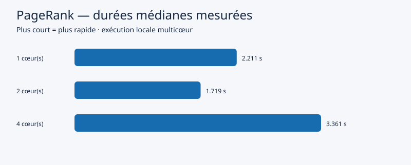

# Comparaison PageRank

10000 sommets, 80000 liens, 20 itérations.
Spark 3.5.3 ; Java 17.0.12. Un échauffement avant chaque série.

| Cœurs Spark | Médiane (s) | Min (s) | Max (s) | Répétitions | Accélération | Efficacité |
|---|---|---|---|---|---|---|
| 1 | 2.211 | 1.607 | 2.294 | 3 | 1.00 | 100.0% |
| 2 | 1.719 | 1.319 | 2.268 | 3 | 1.29 | 64.3% |
| 4 | 3.361 | 1.967 | 3.679 | 3 | 0.66 | 16.4% |

Accélération = médiane à 1 cœur / médiane à p cœurs.
Efficacité = accélération / p. Les cœurs désignent les threads de calcul autorisés à Spark.
Mesures locales sur un seul hôte, graphe déjà chargé. Le démarrage JVM et les exports sont exclus.
Ce protocole fait varier le parallélisme et le partitionnement par défaut de Spark ; ce n'est pas un test à partitionnement fixe.
Le coût de coordination peut dépasser le gain sur de petits graphes. Une accélération n'est pas garantie.
Pour comparer deux machines, conserver le même jeu de données et documenter CPU, RAM, système et charge.

